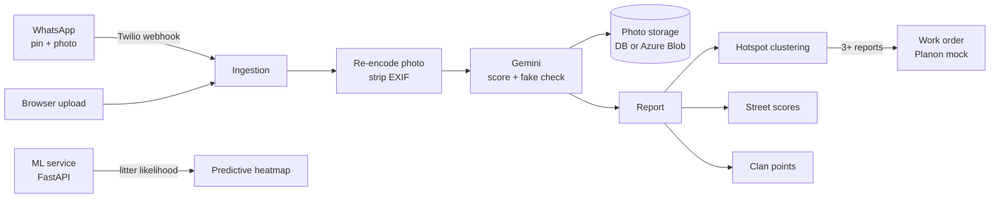

# Leuven Go

[](https://github.com/ZakariaShahruri/HackTheWaste/actions/workflows/ci.yml)

**Cleanliness, gamified.** Residents send one photo and a location pin over
WhatsApp. An AI rates how dirty the spot is, nearby reports merge into a single
hotspot, and once enough people report the same place the city gets a work
order. Students earn points for their faculty clan along the way.

Built in 24 hours by team ReCode for a KU Leuven hackathon, which it won, and
since then hardened into something that runs for real.

It has two views over the same data:

| View             | For                | What it shows                                                                                       |
| ---------------- | ------------------ | --------------------------------------------------------------------------------------------------- |
| **Professional** | City teams         | Hotspots, street cleanliness scores, a predictive litter heatmap, the work-order queue for crews    |
| **Student**      | KU Leuven students | Clan territories on the map, the clan leaderboard, a photo feed, the rewards marketplace            |

## How it works



1. **Report.** Over WhatsApp you send a location pin, then a photo. Without
   WhatsApp, the report page's "In your browser" tab takes the same photo and
   a spot (your location or a tap on the map) and posts them to
   `POST /api/demo-reports`, which runs the exact same pipeline. The browser
   turns the photo upright and shrinks it to 1600 px before uploading, and
   the demo takes 5 uploads per visitor per hour.
2. **Check.** The photo is re-encoded to a JPEG of at most 1280 px, which also
   drops EXIF data such as GPS. Gemini scores it from 0 (filthy) to 100 (clean)
   and rejects screenshots and stock photos. Pins outside Leuven are refused.
3. **Cluster.** A report within 40 m of a hotspot that hasn't been cleaned up
   yet joins it; otherwise it opens a new one. At 3 reports the hotspot
   escalates to a work order whose priority depends on how dirty the spot is
   and how many people reported it. Later reports there join the same order
   until a crew marks it done.
4. **Score.** Each street segment's score is a recency-weighted average of the
   reports within 80 m, pulled towards a neutral prior so that one photo can't
   swing a street to 0 or 100:

   ```
   score = (85 * 1 + Σ wᵢ * scoreᵢ) / (1 + Σ wᵢ)      wᵢ = 0.5 ^ (ageᵢ / 24h)
   ```

   Scores are refreshed after every report and hourly, so streets drift back
   to the prior as reports age.
5. **Reward.** Each report earns its clan `10 + (100 - score) / 2` points, from
   10 for a clean street to 60 for a filthy one, so the dirtiest spots are worth
   the most. Text `clan CODE` to the bot to pick
   the clan your WhatsApp reports count for. Browser reports from a logged-in
   account also earn the same points for the account itself, which can be spent
   on rewards in the marketplace; each redemption returns a voucher code.
   Stock and balance are taken with conditional updates, so two people can't
   both get the last item and one balance can't be spent twice.
6. **Predict.** A small scikit-learn model (gradient-boosted trees) estimates how
   likely litter is across Leuven for any weekday and hour: the Oude Markt on a
   Thursday night and the morning after, the station during the day, the campus
   during term. The backend proxies it; browsers never call the ML service
   directly.

## WhatsApp commands

| Send                 | Reply                                                     |
| -------------------- | --------------------------------------------------------- |
| a location pin       | asks for a photo of the spot (valid for 30 minutes)       |
| a photo (after a pin)| the AI's score, its assessment and what it spotted         |
| `clan`               | your current clan and the list of clans                   |
| `clan CODE`          | joins that clan, e.g. `clan APO`                          |

## Security and privacy

- **No phone numbers stored.** WhatsApp senders are identified by an
  HMAC-SHA256 of their number with a server-side secret, and numbers never reach
  the logs. The public feed labels reporters only by channel and rounds
  coordinates to about 10 m.
- **Webhook signatures.** Every Twilio request is checked against
  `X-Twilio-Signature`, and unsigned requests are rejected.
- **Safe media fetching.** Photos are downloaded only over HTTPS from Twilio's
  own host, Twilio credentials are never forwarded on redirects, and downloads
  are size- and type-limited. Images over 50 megapixels are refused before
  decoding.
- **Sessions.** Passwords are BCrypt-hashed. Session tokens are stored only as
  SHA-256 hashes and expire after 7 days. Completing work orders requires the
  crew role.
- **Rate limits** on login, sign-up and browser uploads, keyed on the address
  the hosting proxy saw, so a forged `X-Forwarded-For` doesn't reset them.
- **Fail fast in production.** The prod profile refuses to start without
  `ALLOWED_ORIGINS` and `PSEUDONYM_SECRET`.

## Stack

| Part        | Tech                                                                       |
| ----------- | -------------------------------------------------------------------------- |
| `backend/`  | Java 21, Spring Boot 4.1, Hibernate 7, Flyway; H2 in dev, Postgres in prod |
| `frontend/` | React 19, TypeScript, Vite 8, react-router, React-Leaflet, OSM tiles       |
| `ml/`       | Python 3.13, FastAPI, scikit-learn                                         |
| AI          | Google Gemini (`gemini-2.5-flash-lite` by default)                         |
| Messaging   | Twilio WhatsApp                                                            |
| Hosting     | Vercel (frontend); Railway (backend, ML, Postgres), both built from their Dockerfiles |

## Running it locally

You need Java 21, Maven, Node 22 and Python 3.13. Nothing else: dev uses an
in-memory H2 database and seeds itself with a demo Leuven, including a crew
account (`crew@leuvengo.demo` / `cleanleuven`) for the operations page.

The demo data is a week of reports played through the real pipeline: a few
spots people keep reporting (Oude Markt after a night out, the station), some
of them already cleaned up, a couple of clean streets and scattered one-offs.
So the dashboards open with work orders in every state, a spread of street
scores and a feed with photos. Every night at 04:00 (Leuven time) a demo
instance throws away all reports, hotspots, work orders and photos, uploads
included, and replays a fresh week, so the history never goes stale. A host
that sleeps when idle misses that run, so an instance that starts on a week
more than a day old replays it before serving requests, and street scores are
recomputed at every start. Accounts, their points and redeemed vouchers are
kept. `LEUVENGO_DEMO_ENABLED=false`
turns all of this off and keeps only the clans, streets and rewards.

```bash
# backend → http://localhost:8080
cd backend && mvn spring-boot:run

# frontend → http://localhost:5173 (proxies /api to the backend)
cd frontend && npm install && npm run dev

# ML service → http://localhost:8000 (only needed for the predictive heatmap)
cd ml && python3.13 -m venv venv && venv/bin/pip install -r requirements.txt
venv/bin/uvicorn api:app --port 8000
# optional: regenerate the training data and retrain (deterministic)
venv/bin/python generate_data.py && venv/bin/python train.py
```

If port 8080 is taken, run the backend with `--server.port=8099` and the
frontend with `VITE_PROXY_TARGET=http://localhost:8099 npm run dev`.

To run it the way production does, with Postgres and the prod profile, Docker
Compose builds and starts the backend, the ML service and the database:

```bash
docker compose up --build --wait   # backend → http://localhost:8080
cd frontend && npm run dev
```

Set `BACKEND_PORT` to publish the backend elsewhere, and `GEMINI_API_KEY` to
score photos. The data lives in the `db-data` volume; `docker compose down -v`
starts over.

Without a `GEMINI_API_KEY`, photos still go through the pipeline but get a
neutral score that is labelled "AI offline, demo score".

## Configuration

The backend reads environment variables (see `backend/.env.example`):

| Variable                          | Needed       | Purpose                                                       |
| --------------------------------- | ------------ | ------------------------------------------------------------- |
| `SPRING_PROFILES_ACTIVE`          | prod         | `prod` switches to Postgres and the strict settings           |
| `SPRING_DATASOURCE_URL` / `_USERNAME` / `_PASSWORD` | prod | Postgres connection                              |
| `ALLOWED_ORIGINS`                 | prod         | Comma-separated frontend origins for CORS                     |
| `PSEUDONYM_SECRET`                | prod         | HMAC key for sender pseudonyms; keep it stable                |
| `ML_API_URL`                      | optional     | ML service, default `http://localhost:8000`                   |
| `GEMINI_API_KEY`, `GEMINI_MODEL`  | optional     | Photo scoring                                                 |
| `TWILIO_ACCOUNT_SID`, `TWILIO_AUTH_TOKEN` | WhatsApp | Media downloads and webhook signatures                     |
| `TWILIO_WEBHOOK_URL`              | WhatsApp     | The exact webhook URL configured in Twilio                    |
| `AZURE_STORAGE_CONNECTION_STRING`, `AZURE_STORAGE_CONTAINER` | optional | Store photos in Azure Blob instead of the database |
| `LEUVENGO_DEMO_ENABLED`           | optional     | Default `true`: seed a week of demo reports and the crew login |
| `LEUVENGO_DEMO_RESET_CRON`        | optional     | When the demo resets, default `0 0 4 * * *`; `-` disables it  |

The frontend reads `VITE_API_BASE_URL`, `VITE_WHATSAPP_NUMBER` and
`VITE_WHATSAPP_JOIN_CODE`, plus `SITE_URL` at build time for the absolute
social preview image URL; Vercel builds use the production URL instead (see
`frontend/.env.example`).

## API

| Method | Path                                | Purpose                                          |
| ------ | ----------------------------------- | ------------------------------------------------ |
| POST   | `/api/whatsapp/webhook`             | Twilio webhook (signed)                          |
| POST   | `/api/demo-reports`                 | Browser upload: `photo`, `lat`, `lng`, `clan`?   |
| GET    | `/api/photos/{id}`                  | A stored report photo                            |
| GET    | `/api/feed`                         | Photo feed, paged, optional `?clan=`             |
| GET    | `/api/hotspots`, `/api/hotspots/active` | Hotspots                                     |
| GET    | `/api/segments`                     | Street segments with their scores                |
| GET    | `/api/faculties`                    | Clans with their territories                     |
| GET    | `/api/leaderboard`                  | Clans ranked by points                           |
| GET    | `/api/stats`                        | Dashboard figures and the 7-day trend            |
| GET    | `/api/predictions/grid`             | Litter likelihood grid, `?day=0..6&hour=0..23`   |
| GET    | `/api/rewards`                      | Rewards marketplace                              |
| POST   | `/api/rewards/{id}/redeem`          | Spend points on a reward, returns a voucher      |
| GET    | `/api/rewards/mine`                 | The logged-in user's redeemed rewards            |
| GET    | `/api/work-orders`                  | Work orders                                      |
| POST   | `/api/work-orders/{id}/complete`    | Crew only: resolves the hotspot                  |
| POST   | `/api/work-orders/dispatch/{hotspotId}` | Escalate a hotspot by hand                   |
| POST   | `/api/auth/register`, `/login`, `/logout` | Accounts                               |
| GET    | `/api/auth/me`                      | The logged-in user, including their points       |
| GET    | `/actuator/health`                  | Health check (app and database), no details      |

Errors always come back as the same JSON shape (`status`, `error`, `message`,
`path`, `timestamp`), never as stack traces.

## Tests

```bash
cd backend  && mvn clean verify                       # unit + integration tests
cd frontend && npm run lint && npm run typecheck && npm test && npm run build
cd ml       && pip install -r requirements-dev.txt && pytest
```

The backend suite includes a test that boots the app on a real Postgres in
Docker (Testcontainers), so the Flyway migrations and entity mappings are
checked against the production database. It is skipped when Docker isn't
running. GitHub Actions runs all three suites on every push, then builds the
images, starts the compose stack and runs `scripts/smoke.sh` against it. The
same script checks a deployed backend: `scripts/smoke.sh https://<backend-url>`.

## Limitations

- **The ML model is trained on synthetic data**, generated from a hand-written
  prior about when and where Leuven gets messy (nightlife, shopping streets,
  campus term time, parks; see `ml/generate_data.py`). Its R² is measured
  against that same prior, so it shows the pipeline, not real-world accuracy.
- **The demo resets nightly.** Anything reported on the live demo is gone the
  next morning (see above).
- **Demo photos are drawn, not taken.** The seeded feed shows illustrated
  street scenes generated by the app, with more litter for dirtier scores.
  Reports sent in over WhatsApp or the browser keep their real photos.
- **Planon is mocked.** Work orders get a Planon-style reference, but nothing is
  sent to a real Planon instance.
- **Rate limits are in memory**, so they are per instance. That's fine for a
  single-instance deployment.
